# kerberized-nfs-lab

A Linux identity and storage lab built from scratch on UTM virtual machines, in three phases:

1. **Directory (complete):** central identity in **389 Directory Server**, served over **TLS** from a private CA, consumed by **SSSD** clients, with DNS, time, access control, backups and a tested restore.
2. **Kerberos (complete):** an **MIT Kerberos** realm whose database lives in the same directory. Logins yield tickets, SSH is single sign-on, and machines read the directory with their own keytabs instead of a shared bind password.
3. **Kerberized NFS (complete):** a third host serves NFSv4 with `sec=krb5p`. Every file request carries the user's Kerberos ticket and is encrypted on the wire; the server decides who is asking from the ticket, not from the client's word.

This is a rebuild and extension of my earlier [linux-ldap-lab](https://github.com/OB-Adams/linux-ldap-lab). Every step is backed by a screenshot or a log in this repository.

## Contents

- [Architecture](#architecture)
- [Status](#status)
- [Phase 1: directory](#phase-1-directory)
- [Phase 2: Kerberos](#phase-2-kerberos)
- [Phase 3: Kerberized NFS](#phase-3-kerberized-nfs)
- [Design decisions](#design-decisions)
- [Operations](#operations)
- [Troubleshooting highlights](#troubleshooting-highlights)
- [Known trade-offs](#known-trade-offs)
- [Repository layout](#repository-layout)
- [Possible extensions](#possible-extensions)

## Architecture

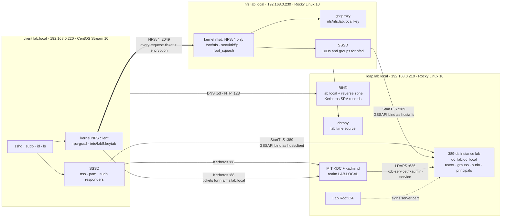

| Layer | Component | Role |
|---|---|---|
| Foundations | BIND, chrony | Every host resolves every other by one canonical name, forward and reverse; clients find the KDC through SRV records; all clocks follow ldap (Kerberos rejects more than 5 minutes of skew) |
| Identity | 389-ds | One source of truth for users, groups, UID/GID numbers, sudo rules and Kerberos principals |
| Authentication | MIT Kerberos (kldap backend) | Passwords are checked once by the KDC; after that, tickets prove identity to SSH and LDAP |
| Transport | Private CA, StartTLS/LDAPS | Encrypts directory traffic and proves the server's identity |
| Clients | SSSD, authselect, oddjob-mkhomedir | Linux lookups (NSS) and logins (PAM): identity from the directory, authentication from Kerberos |
| Storage | NFSv4 server, gssproxy, rpc-gssd | Files served with every request authenticated by the user's ticket and encrypted (`sec=krb5p`); permissions decided by the server from the directory |
| Operations | Scripts, systemd timer | User lifecycle, health check, nightly backup, restore |

UTM bridged networking on 192.168.0.0/24. SELinux is enforcing and firewalld is on for every host.

## Status

| Milestone | Status |
|---|---|
| M0 Foundations: static IPs, DNS, time | done |
| M1 Directory | done |
| M2 TLS | done |
| M3 Access control | done |
| M4 Client (SSSD) | done |
| M5 Operations: lifecycle, health check, backup, restore drill | done |
| M6 Write-up | done |
| K1 Kerberos preparation: schema, indexes, SRV records, service accounts | done |
| K2 Realm `LAB.LOCAL` in 389-ds | done |
| K3 User principals, policy, lockout | done |
| K4 Client in the realm: host keytab, Kerberos logins, SSH single sign-on | done |
| K5 Keytab-based LDAP binds (SASL/GSSAPI) | done |
| N1 nfs.lab.local joins: keytab, host identity, SSSD | done |
| N2 NFS server: NFSv4 only, `sec=krb5p` export, gssproxy | done |
| N3 Client mount and proofs: root squash, no-ticket denial, shared directory, packet capture | done |
| N4 Write-up | done |

## Phase 1: directory

### M0 Foundations: DNS and time

- BIND on ldap is authoritative for `lab.local` and `0.168.192.in-addr.arpa`, and forwards everything else. Recursion is limited to the lab subnet.
- **One name per IP**, so forward and reverse lookups always agree. Kerberos builds service principal names from host names.
- chrony on ldap serves time to the lab (`allow 192.168.0.0/24`, `local stratum 10`), and `makestep 1.0 -1` lets paused VMs catch up at once.

Configs: [`configs/dns/`](configs/dns), [`configs/chrony/`](configs/chrony)

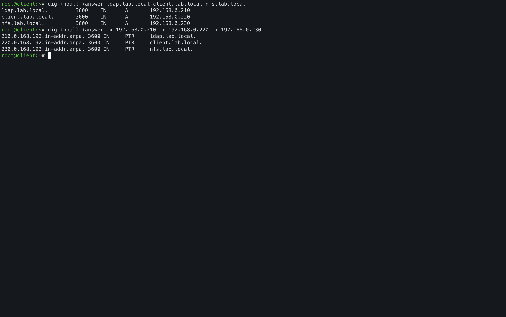
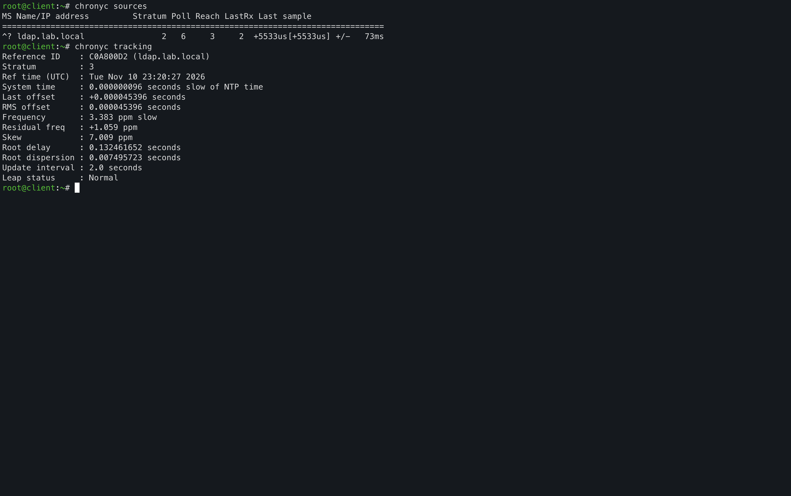

### M1 Directory

- 389-ds instance `lab`, created from [`configs/389ds/lab.inf.example`](configs/389ds/lab.inf.example), with backend `userroot` for `dc=lab,dc=local`.
- **rfc2307bis groups:** `groupOfNames` + `posixGroup` (via the rfc2307compat schema), with members stored by DN. The **memberOf** plugin writes the reverse link onto each user.
- UIDs and GIDs start at 10000, clear of local accounts. Equality indexes on `uidNumber`, `gidNumber`, `member` and `memberOf` are confirmed: lookups don't log `notes=U`.

Tree: `ou=People` (kofi, ama, yaw), `ou=Groups` (ldapusers, sysadmins), `ou=Services` (sssd-bind, later kdc-service and kadmin-service), `ou=SUDOers`. Source: [`ldif/structure.ldif`](ldif/structure.ldif). K5 adds `ou=Hosts` ([`ldif/hosts.ldif`](ldif/hosts.ldif)).

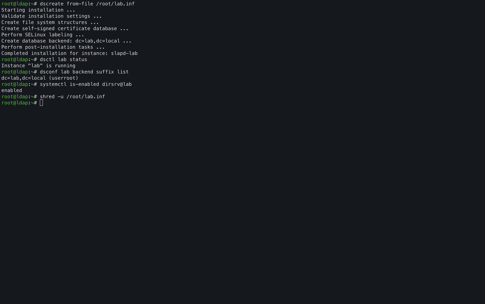
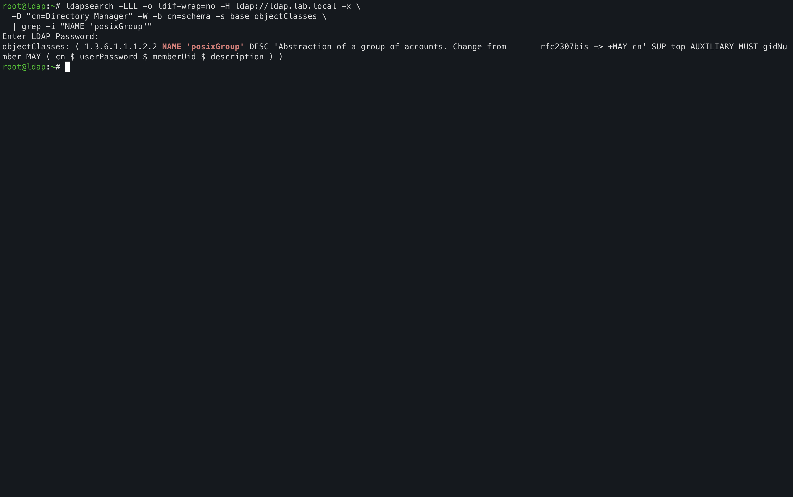
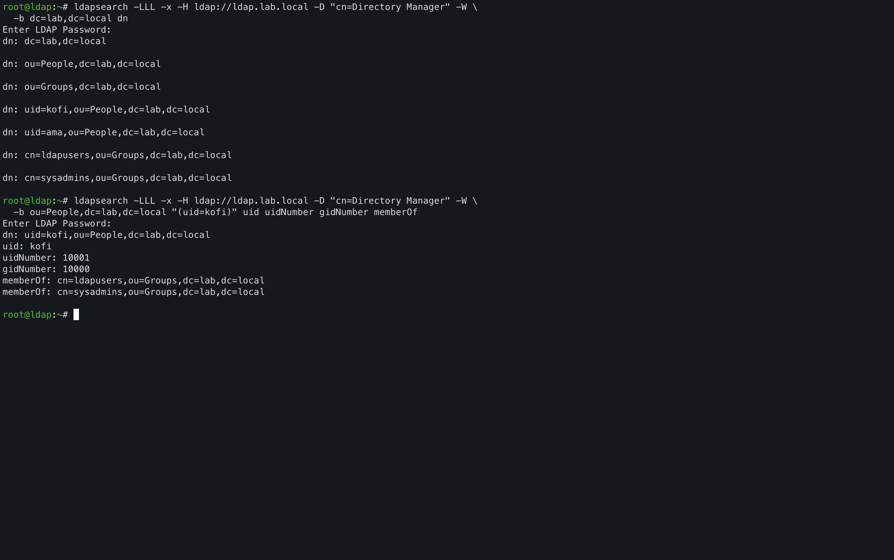
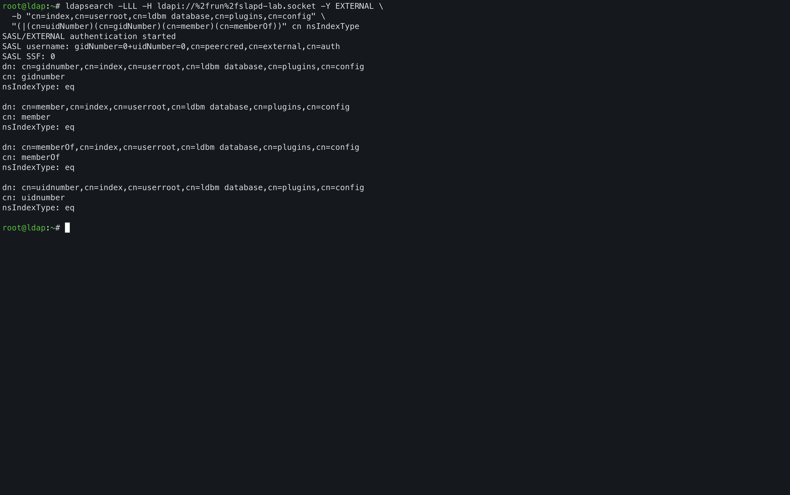

### M2 TLS

- A private root CA ("Lab Root CA", 10 years) signs a server certificate for `ldap.lab.local`, valid for 397 days. It has a SAN, `CA:FALSE` and `serverAuth` only. Extension files: [`configs/tls/`](configs/tls)
- The CA is installed in each host's system trust store. StartTLS on 389 and LDAPS on 636 both verify, including the hostname.
- The negative tests are part of the evidence: an untrusted CA fails with verify code 19, and connecting by IP fails with code 64 (IP address mismatch).

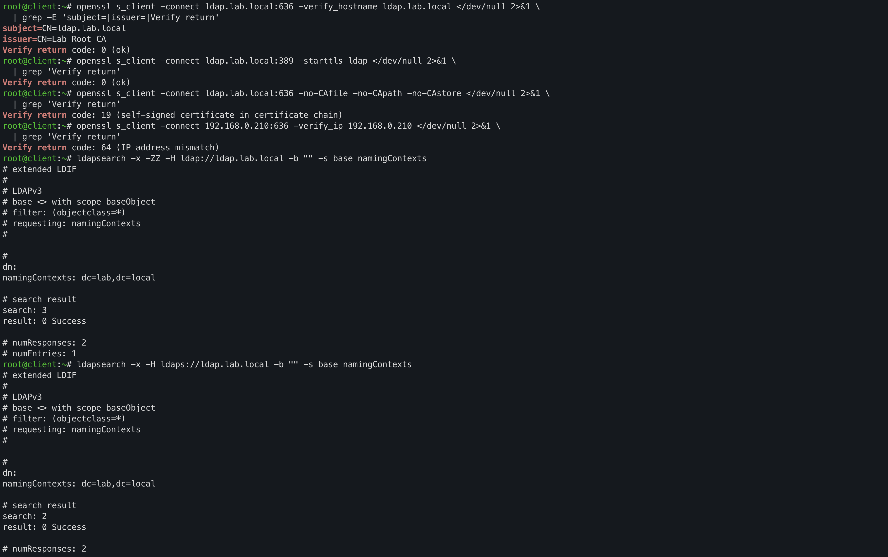

### M3 Access control

- **Password binds require TLS** (`nsslapd-require-secure-binds=on`). Without TLS a bind fails with 13.
- **Anonymous clients can read only the rootDSE** (`nsslapd-allow-anonymous-access=rootdse`). Anything else fails with 48.
- **SSSD binds as `sssd-bind`**, a read-only service account (replaced by host keytabs in K5). **Allow-list ACIs** expose exactly the attributes SSSD needs and never `userPassword`. Users may change only their own password. Source: [`ldif/aci.ldif`](ldif/aci.ldif)
- **Password policy:** minimum length 12, and 3 failed binds lock the account for 5 minutes. `ou=Services` has its own subtree policy with no lockout (see [troubleshooting](#troubleshooting-highlights)).
- **Audit:** the only default ACI left is "Enable anyone domain read" on the suffix entry. A logged-in ordinary user (ama) cannot read other users.

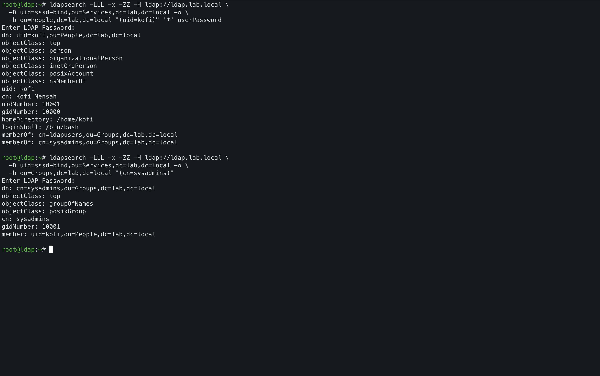
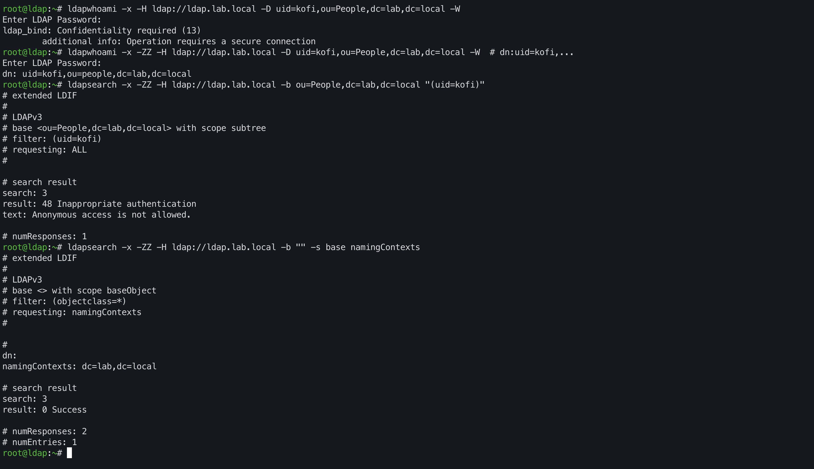
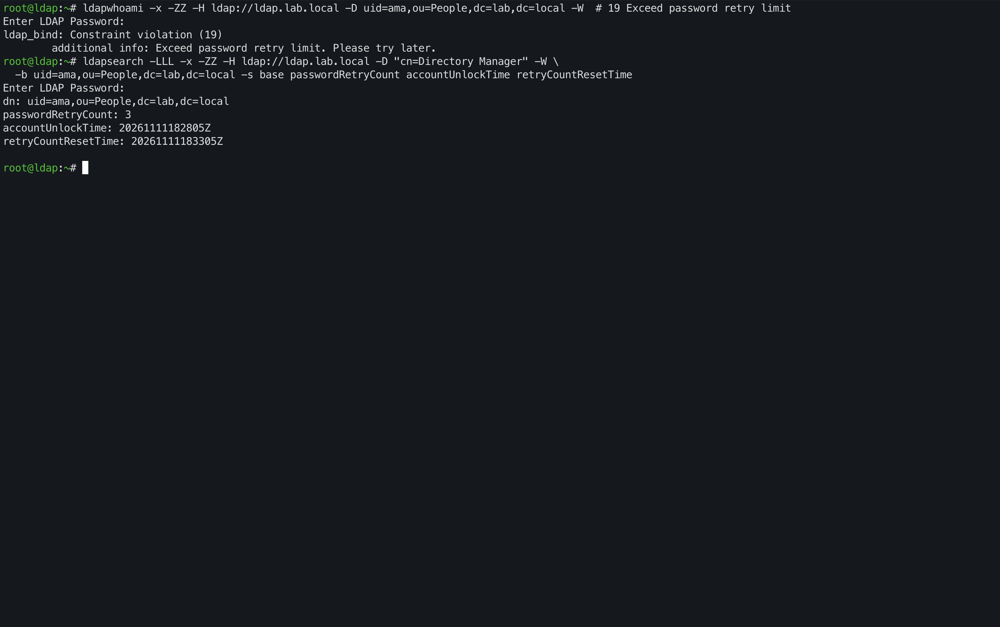

### M4 Client

- SSSD with `ldap_schema = rfc2307bis`, StartTLS and `ldap_tls_reqcert = demand`. Config: [`configs/sssd/sssd.conf.example`](configs/sssd/sssd.conf.example)
- `authselect select sssd with-mkhomedir with-sudo` wires NSS and PAM to SSSD and creates home directories at first login.
- **Login authorization:** `access_provider = simple`, `simple_allow_groups = sysadmins`. kofi logs in; ama's password is correct, but she is refused at the PAM *account* step.
- **Sudo rules come from the directory:** `cn=%sysadmins,ou=SUDOers` gives members of `sysadmins` sudo on every SSSD host, with its own allow-list ACI. Source: [`ldif/sudo.ldif`](ldif/sudo.ldif), [`ldif/aci-sudo.ldif`](ldif/aci-sudo.ldif)

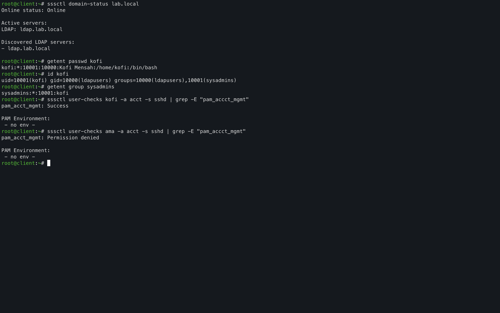
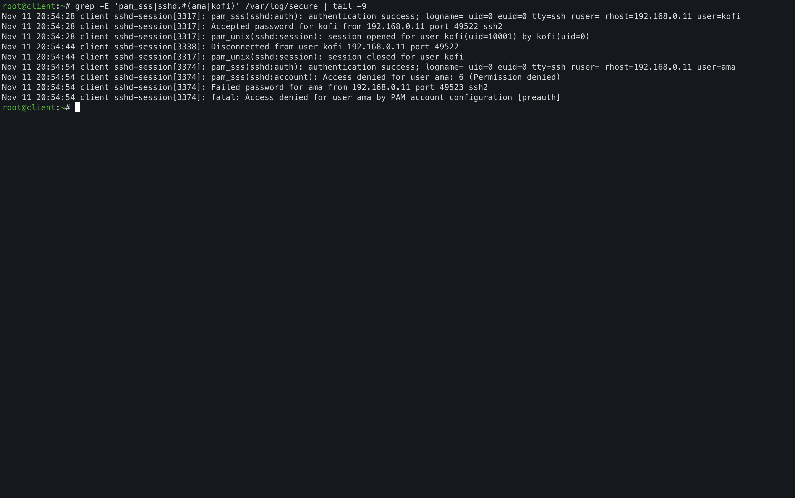
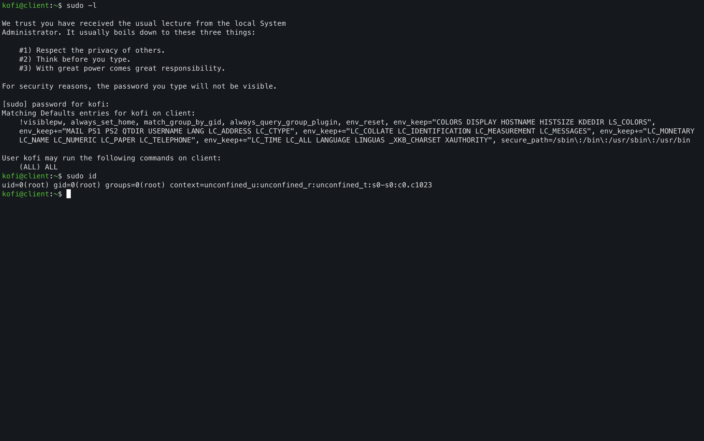

**Reading the login log:** when a user with the right password is refused by `simple_allow_groups`, sshd still logs `Failed password for <user>`, because it reports any PAM failure that way. The pair of `pam_sss` lines above it shows the real cause: `authentication success`, then `account ... Access denied`.

### M5 Operations

See [Operations](#operations).

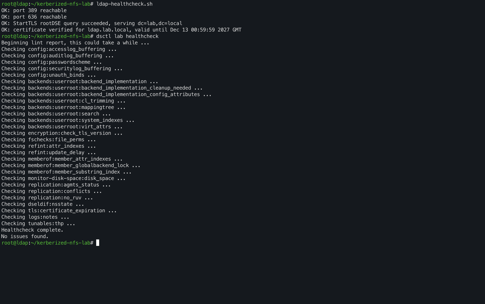
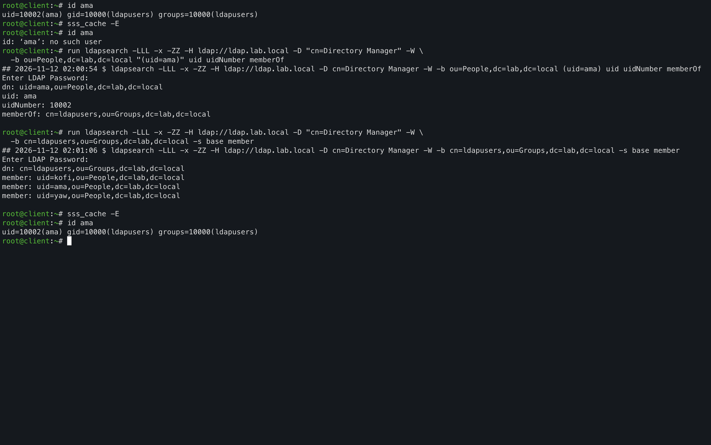
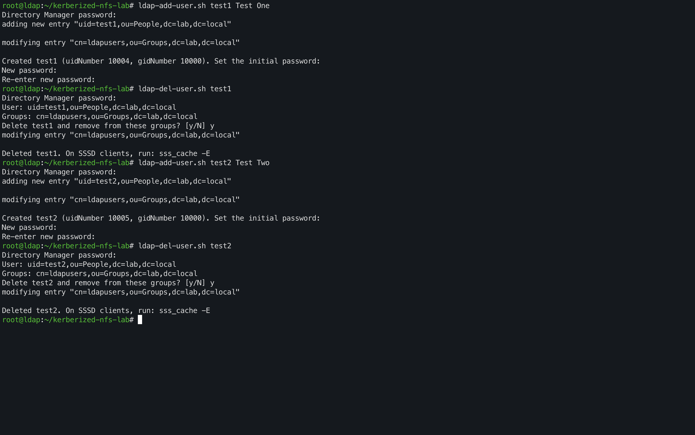

## Phase 2: Kerberos

How it fits together: the KDC stores every principal in 389-ds, under `cn=krbcontainer` for service principals and **on the users' existing entries** for people. A login sends the password to the KDC once and leaves a ticket-granting ticket (TGT); after that, tickets prove identity to sshd and to the directory. The client and service roles belong to each exchange, not to a principal: `host/client.lab.local` is the *service* when kofi logs in (K4) and the *client* when SSSD reads the directory (K5).

### K1 Preparation

- The Kerberos schema (`60kerberos.ldif`) is loaded into 389-ds; `krbPrincipalAux` is an auxiliary class, so a user entry can carry Kerberos attributes beside its posix ones. Equality indexes on `krbPrincipalName` and `krbCanonicalName`, which the KDC searches on every request.
- **The KDC is found through DNS:** `_kerberos` TXT gives the realm, and SRV records give the KDC (88), the admin server (749) and the password service (464). [`configs/dns/lab.local.zone`](configs/dns/lab.local.zone)
- Two bind identities in `ou=Services`: `kdc-service` for the KDC and `kadmin-service` for kadmind. [`ldif/krb-services.ldif.example`](ldif/krb-services.ldif.example)

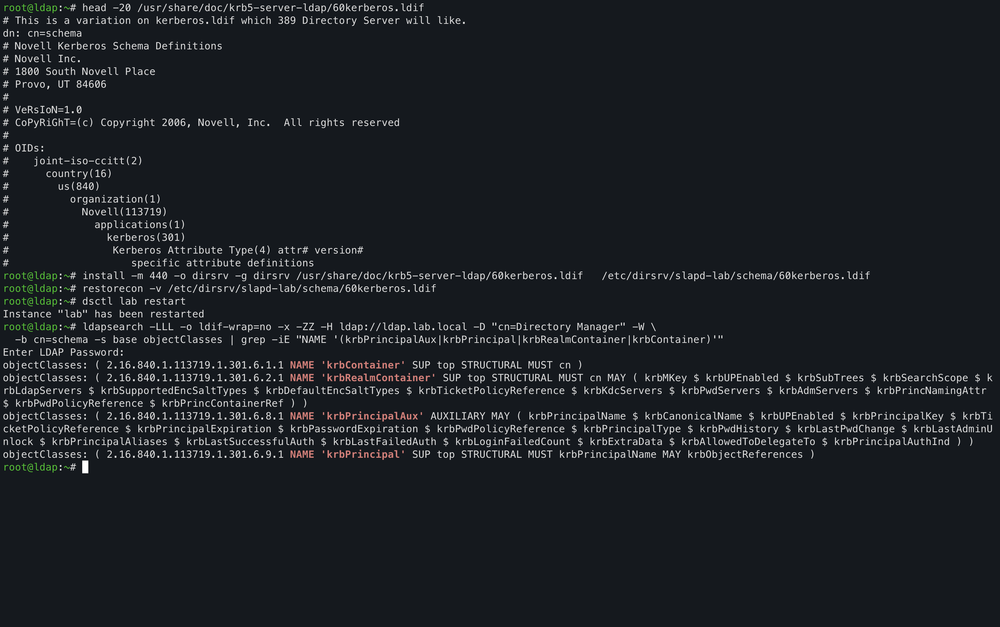
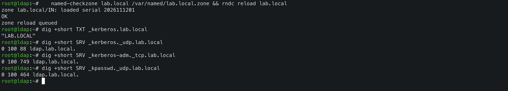

### K2 Realm

- [`configs/krb5/kdc.conf`](configs/krb5/kdc.conf) uses the `kldap` database module over LDAPS. `kdb5_ldap_util create` built realm `LAB.LOCAL` in `cn=krbcontainer,dc=lab,dc=local` (master key, `krbtgt`, `kadmin/*`).
- Principal keys in the directory are encrypted with the **master key**, which is stashed only on ldap's disk and never stored with the directory or its backups. The two service-account passwords sit in a root-only `ldap.stash`.
- [`ldif/aci-krb.ldif`](ldif/aci-krb.ldif): the KDC can read principals but write only login bookkeeping; kadmind manages Kerberos attributes but can never delete entries or touch posix attributes or `userPassword`. Admins are `*/admin` principals ([`configs/krb5/kadm5.acl`](configs/krb5/kadm5.acl)).
- All new principals require pre-authentication (`+preauth`). Tickets last 24 h, renewable for 7 days.

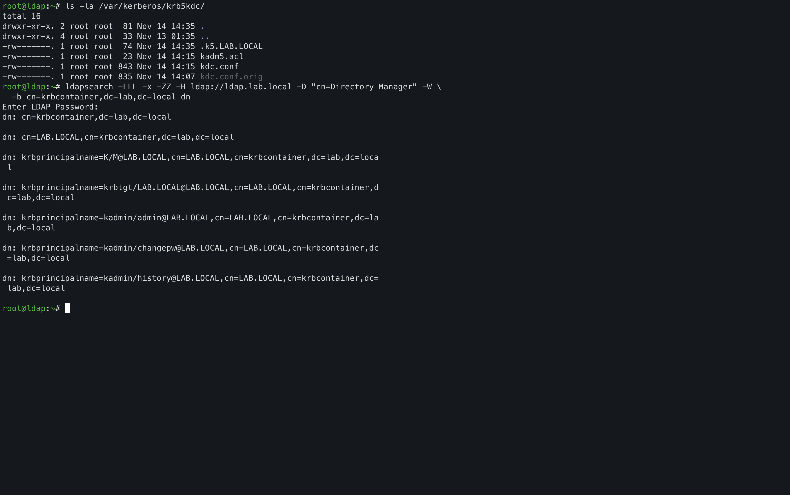
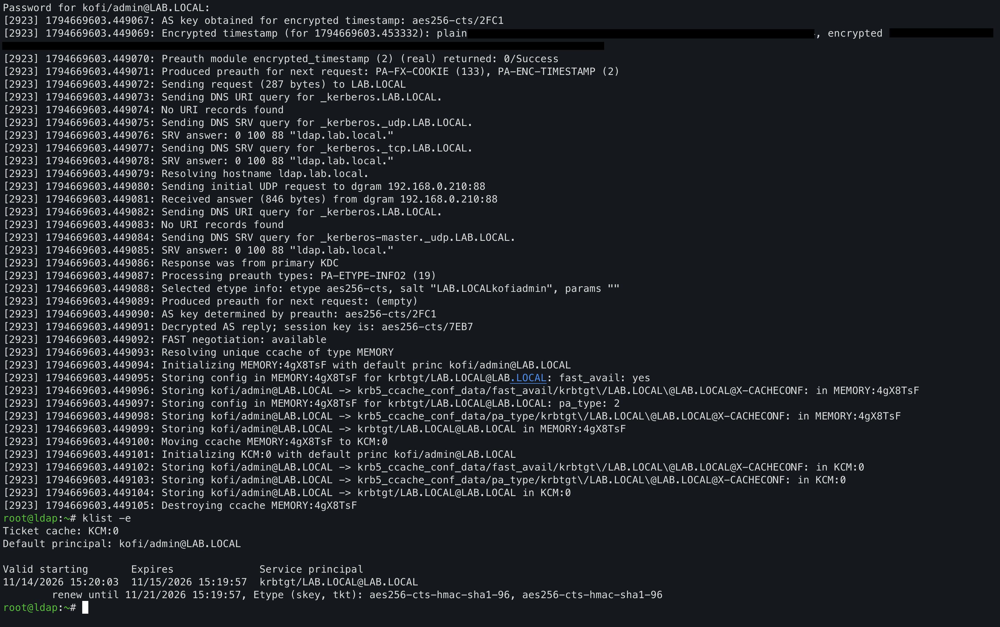

### K3 Users

- kofi, ama and yaw got principals **on their existing `uid=` entries** (`addprinc -x dn=...`), so one entry holds the posix identity and the Kerberos keys.
- Kerberos password policy `users`: minimum length 12, two character classes, and 5 failures within 10 minutes lock the principal for 5 minutes (`KDC_ERR_CLIENT_REVOKED`).
- **Audit:** `sssd-bind` sees identity attributes only and cannot see `cn=krbcontainer`; `kdc-service` sees Kerberos attributes only.

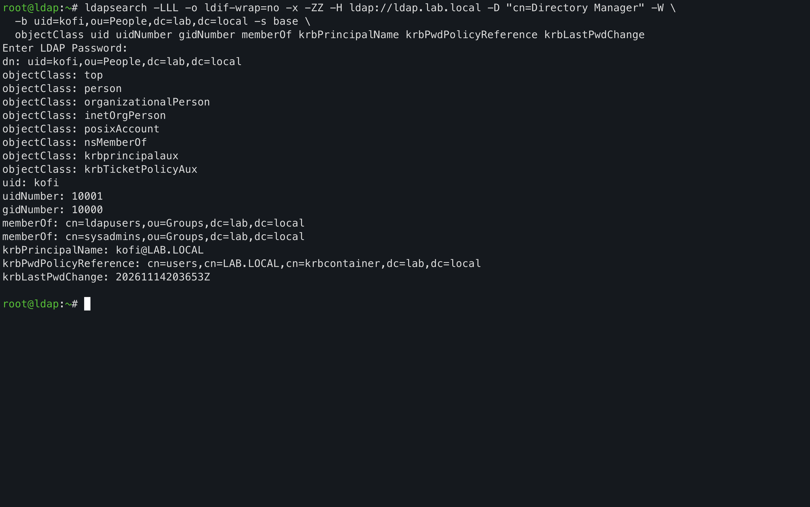
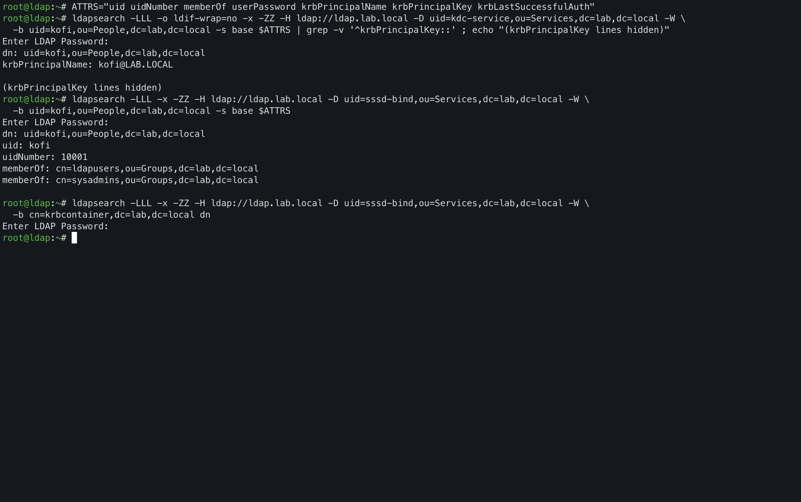
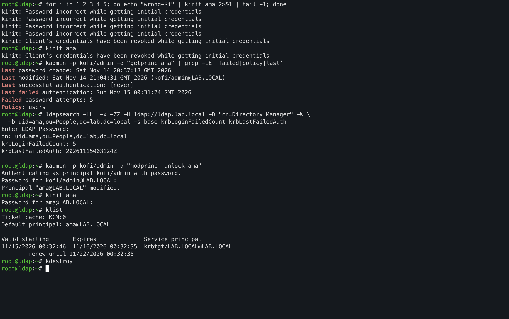

### K4 Client in the realm

- [`configs/krb5/krb5.conf`](configs/krb5/krb5.conf) on every host: realm `LAB.LOCAL`, KDC from DNS (`dns_lookup_kdc = true`, no `kdc =` line).
- `host/client.lab.local` in `/etc/krb5.keytab` (AES keys).
- **SSSD authenticates with Kerberos:** `auth_provider = krb5`. A password login leaves a TGT in the user's KCM cache. `krb5_validate = true` makes SSSD request a ticket for its own host principal and decrypt it with the keytab, which proves the TGT came from the real KDC.
- **SSH single sign-on:** with a TGT on ldap, `ssh client.lab.local` logs in with no password (GSSAPI) and forwards the TGT, so kofi arrives on client already holding tickets.
- The KDC and kadmind need the directory to read their database, so systemd drop-ins order them after it and require it: [`configs/systemd/krb5kdc.service.d/`](configs/systemd/krb5kdc.service.d), [`configs/systemd/kadmin.service.d/`](configs/systemd/kadmin.service.d)

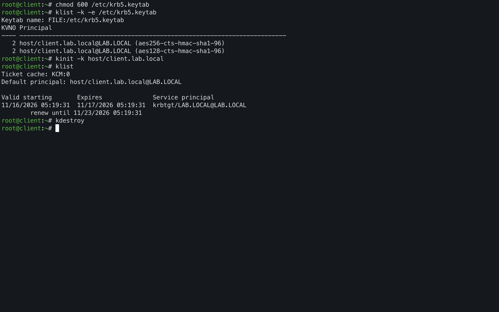
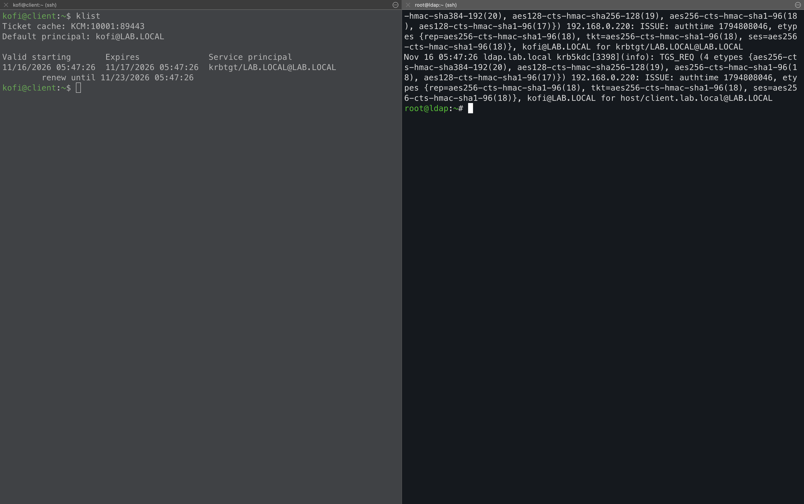
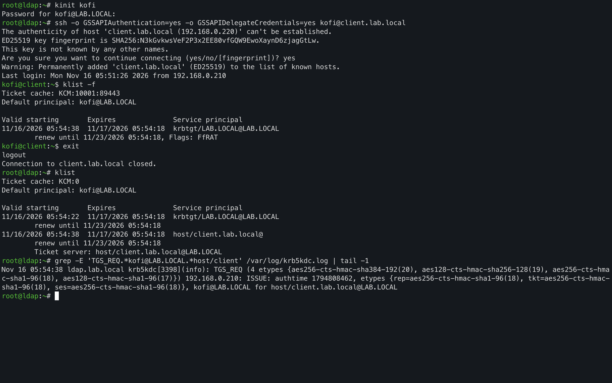

### K5 Keytab-based LDAP binds

The directory now accepts Kerberos tickets, and SSSD reads it as the machine instead of with a shared password.

- **The directory is a Kerberos service:** principal `ldap/ldap.lab.local`, keytab owned by `dirsrv` and passed through `KRB5_KTNAME` ([`configs/systemd/dirsrv@lab.service.d/10-keytab.conf`](configs/systemd/dirsrv@lab.service.d/10-keytab.conf)). Users bind with their tickets: `ldapwhoami -Y GSSAPI` returns kofi's DN with no password typed.
- **Hosts have LDAP identities:** `cn=client.lab.local,ou=Hosts` ([`ldif/hosts.ldif`](ldif/hosts.ldif)). A SASL mapping turns `host/<fqdn>` into that entry ([`ldif/sasl-map-hosts.ldif`](ldif/sasl-map-hosts.ldif)), and the read ACIs that served `sssd-bind` now also admit `cn=*,ou=Hosts` ([`ldif/aci-hosts.ldif`](ldif/aci-hosts.ldif)).
- **SSSD binds with the host keytab:** `ldap_sasl_mech = GSSAPI` as `host/client.lab.local`. SSSD gets a TGT from the keytab, then a ticket for `ldap/ldap.lab.local`, and the bind lands on `cn=client.lab.local,ou=hosts`. `sssd.conf` no longer holds a password, and `sssd-bind` is locked.

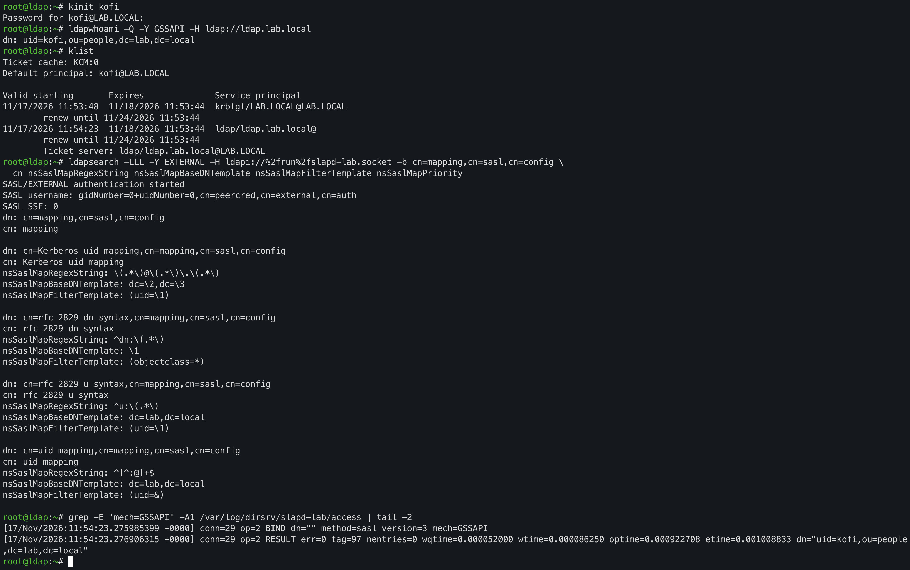
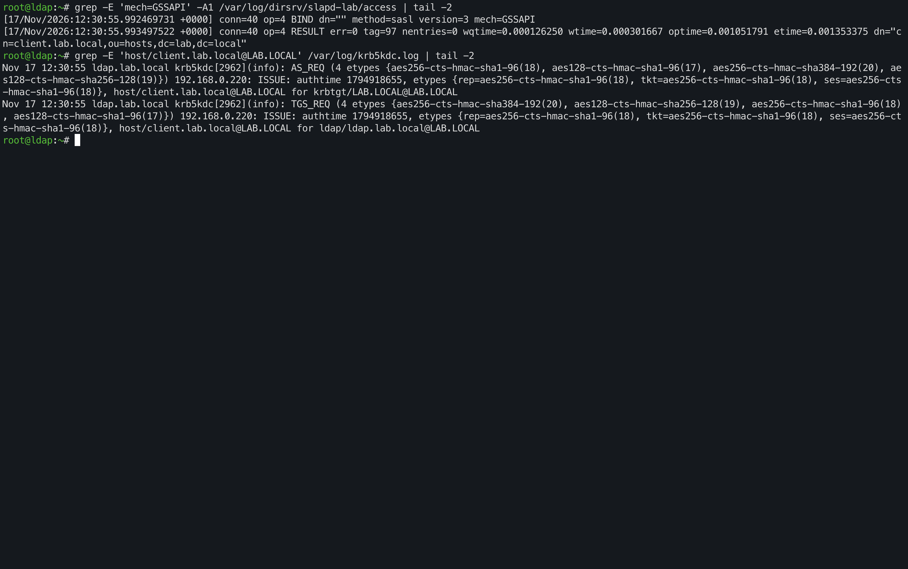

| | Before K5 | After K5 |
|---|---|---|
| Client's secret for directory reads | one `sssd-bind` password, copied to every client | each host's own random key in a root-only keytab |
| Access log identity | every lookup is `sssd-bind` | the host that asked (`cn=client.lab.local`) |
| Cutting off one client | rotate the shared password everywhere | remove that host's entry or principal |
| Adding a host | distribute the password | a keytab and one `ou=Hosts` entry; the mapping and ACIs already cover it |

## Phase 3: Kerberized NFS

Plain NFS (`sec=sys`) trusts the client: each request says "UID 10001" and the server believes it, so root on any allowed client can become anyone. With `sec=krb5p` every request carries a ticket for `nfs/nfs.lab.local` and is encrypted. The server learns **who** is asking from the ticket, then looks up that user's UID and groups **itself**, through its own SSSD, in the same directory. What the client claims about numbers no longer matters.

How one read travels:

1. kofi's process on client touches `/mnt/nfs/...`. The kernel asks **rpc-gssd** for a credential for UID 10001.
2. rpc-gssd finds kofi's TGT in `KCM:10001` and gets a ticket for `nfs/nfs.lab.local` from the KDC.
3. The request reaches nfs with that ticket. The kernel hands it to **gssproxy**, which decrypts it with the `nfs/` key in `/etc/krb5.keytab`: this is `kofi@LAB.LOCAL`.
4. nfs maps kofi to 10001 and his groups through SSSD and LDAP, then applies the ordinary owner, group and mode checks.
5. File owners cross the wire as names (`kofi@lab.local`) and are stored on disk as numbers; idmapd on both sides uses `Domain = lab.local`.

### N1 nfs.lab.local joins

- Same foundations as client: static address, DNS through ldap, chrony with `makestep 1.0 -1`, the lab CA trusted.
- `host/nfs.lab.local` in its own keytab, and one new directory entry, `cn=nfs.lab.local,ou=Hosts`. The K5 SASL mapping and ACIs already cover every `host/*`, so nothing else changed in the directory.
- SSSD with Kerberos authentication and a GSSAPI bind as the host. Only `sysadmins` may log in to the storage server.

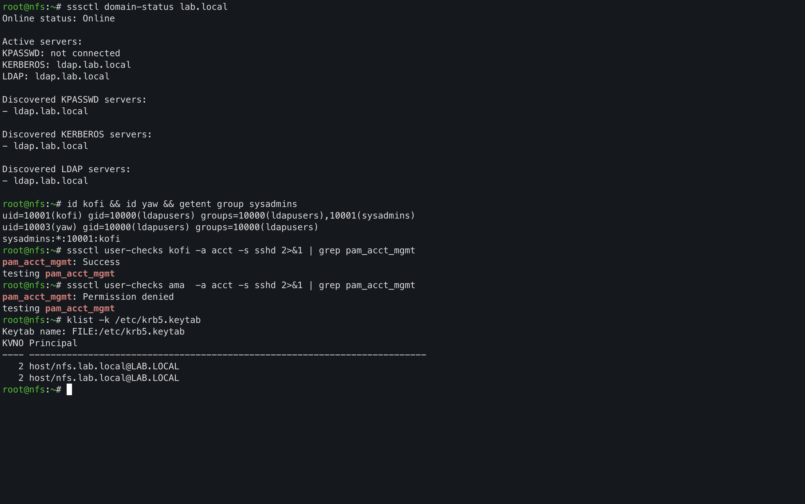
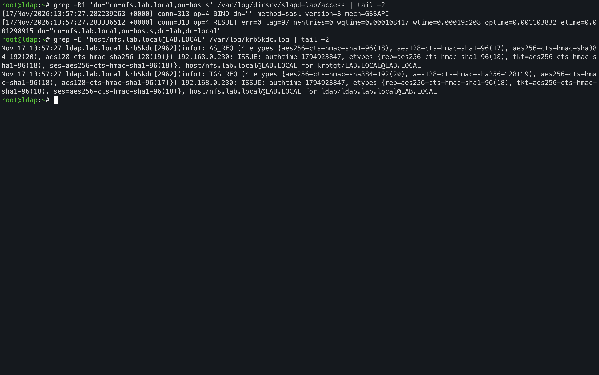

### N2 The server

- `nfs/nfs.lab.local` added to nfs's keytab; **gssproxy** checks tickets for the kernel (`/proc/net/rpc/use-gss-proxy` = 1).
- **NFSv4 only:** `vers3=n` in `/etc/nfs.conf`, and rpcbind and statd masked. One port, 2049/tcp. [`configs/nfs/`](configs/nfs)
- Export [`configs/nfs/lab.exports`](configs/nfs/lab.exports): `/srv/nfs` to `client.lab.local` only, `sec=krb5p` as the **only** flavour, `root_squash`.
- `users/kofi` and `users/yaw` are 0700. `projects` belongs to a new directory group `projects` (kofi, yaw; [`ldif/group-projects.ldif`](ldif/group-projects.ldif)), mode 2770 with a default ACL ([`configs/nfs/projects-acl.sh`](configs/nfs/projects-acl.sh)).

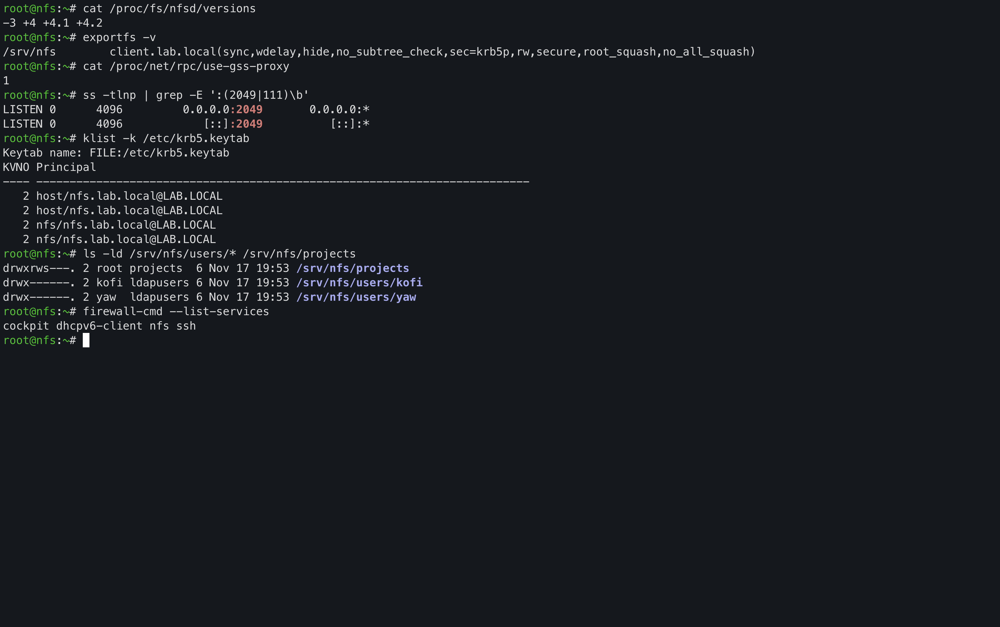

### N3 The client, and the proofs

client.lab.local mounts with `sec=krb5p` at boot ([`configs/nfs/fstab.snippet`](configs/nfs/fstab.snippet)); rpc-gssd fetches tickets for each user, and the mount itself uses the host keytab.

| Claim | Evidence |
|---|---|
| Root on the client gets nothing | root mounts, but is refused kofi's directory and the shared one (32) |
| No ticket, no access, even for the owner | kofi with his tickets destroyed is refused his own directory; after `kinit` it opens, and `klist` shows the new `nfs/nfs.lab.local` ticket (33) |
| Access follows the server's view of owner and group | kofi and yaw each reach their own files and not the other's; both write the shared file (33, 34) |
| Names on the wire, numbers on disk | client shows `kofi projects`, nfs stores `10001 10002` (34) |
| Every user access is backed by a ticket | KDC log: `kofi@LAB.LOCAL` and `yaw@LAB.LOCAL` `for nfs/nfs.lab.local` (34) |
| krb5p encrypts file data | the same marker written over a `sec=krb5` mount appears in a packet capture; over `sec=krb5p` it appears 0 times (35) |

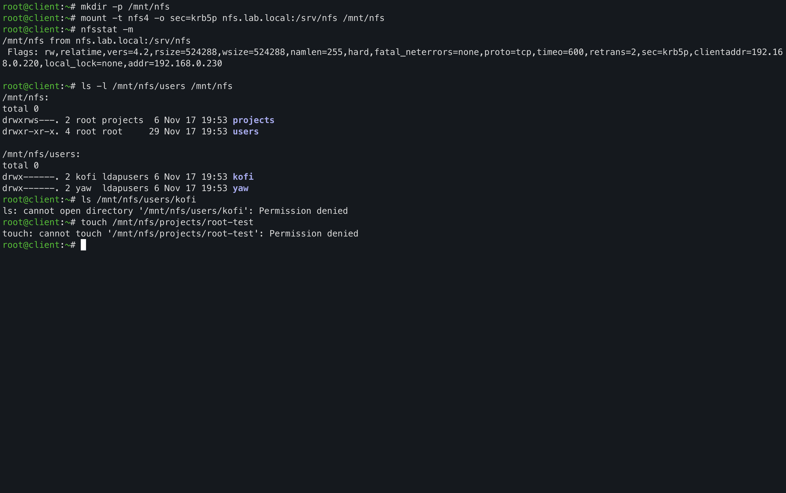
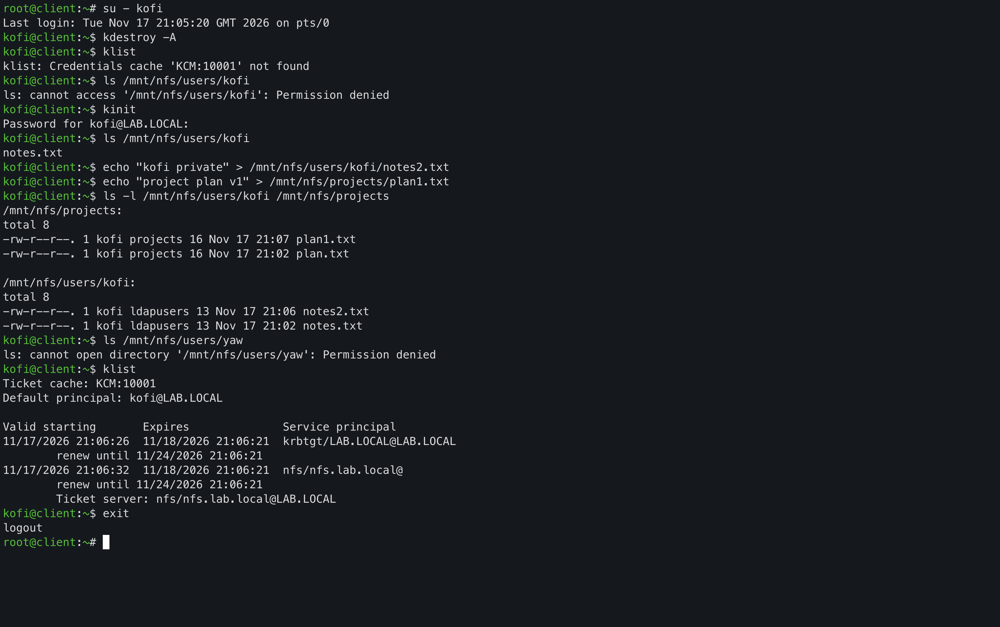
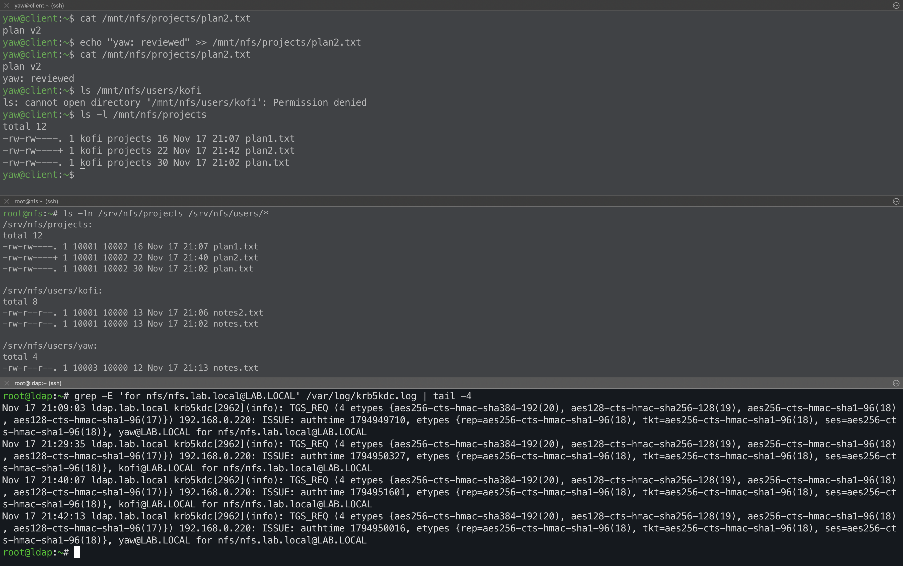
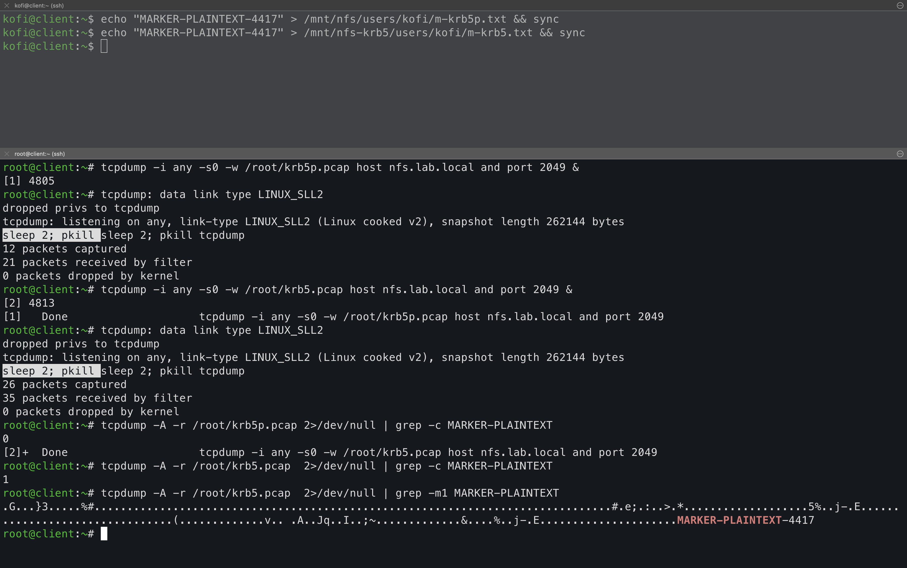

The capture needed the export to accept plain `krb5` for a few minutes; it was put back to `sec=krb5p` only afterwards.

## Design decisions

| Decision | Why | Alternative considered |
|---|---|---|
| Real DNS with reverse zone, one name per IP | Kerberos and TLS both identify hosts by name; `/etc/hosts` copies drift and PTR mismatches break Kerberos | `/etc/hosts` on every host (v1) |
| rfc2307bis + memberOf | Membership by DN keeps references valid, makes "which groups is kofi in?" a single read, and gives ACIs and SSSD a group DN to use | rfc2307 `memberUid` (v1) |
| Allow-list ACIs | Attributes added later stay hidden until granted. This paid off in K3: Kerberos keys landed on user entries and `sssd-bind` could not see them, with no ACI change | `targetattr != "userPassword"` (v1) |
| Service account exempt from lockout, random 32-char password | Lockout on `sssd-bind` lets anyone take every client offline; a long random password makes guessing impractical without lockout | Same policy for every account |
| Login rule per host in `sssd.conf`, sudo rule in LDAP | Different hosts can admit different groups (nfs may admit only admins) while sudo rights stay central | `access_provider = ldap` filter, or FreeIPA-style HBAC |
| DNA plugin assigns `uidNumber` | A deleted user's UID is never reused, so files on shared storage can't pass to a new person | "Highest UID + 1" in the script (v1, and early v2) |
| Private CA instead of a self-signed server cert | Hosts trust one anchor once; later certificates need no client changes | dscreate's self-signed certificate |
| Kerberos database in 389-ds (kldap) | One store for identity and principals; a user's principal lives on the user's own entry; the directory's backups and ACIs cover Kerberos too | The KDC's own `db2` database |
| Separate least-privilege accounts for the KDC and kadmind | The KDC can write only login bookkeeping and kadmind can never delete users; neither needs Directory Manager | Directory Manager in `kdc.conf` |
| KDC located by DNS SRV records | Moving or adding a KDC is a zone change, not an edit on every client | `kdc =` lines in each `krb5.conf` |
| `krb5_validate = true` | Proves each TGT came from the real KDC, defeating a spoofed KDC that answers with a key it chose | Accept any TGT that decrypts with the password |
| Host keytab for LDAP binds (SASL/GSSAPI) | Per-host secret that can be revoked alone, attribution in logs, no password in config files | Shared `sssd-bind` password (M3-K4) |
| NFSv4 only | One port (2049), file owners as names, Kerberos designed in; no rpcbind, mountd or statd on the network | NFSv3 with its helper services |
| The export accepts `sec=krb5p` and nothing else | The server enforces encryption; a client cannot choose a weaker flavour (a `sec=krb5` mount only worked while the export was widened for the capture) | `sec=sys`, or a list of flavours for clients to pick from |
| The server resolves identity itself | Under Kerberos the server maps the ticket's principal to a UID and groups through its own SSSD, so the client's claims carry no weight | Trusting client-supplied UIDs (`sec=sys`) |
| Shared directory: setgid plus a default ACL | setgid keeps new files in group `projects`; the ACL keeps them group-writable whatever each user's umask | `umask 002` for every user on every client |

## Operations

### Scripts

| Script | Purpose |
|---|---|
| [`ldap-add-user.sh`](scripts/ldap-add-user.sh) | Create a user (`uidNumber` assigned by DNA), add `member` to the primary and any extra groups, set the initial password with `ldappasswd -S` |
| [`ldap-del-user.sh`](scripts/ldap-del-user.sh) | Remove the user's `member` values from every group, then delete; refuses if that would leave a group with no members |
| [`ldap-healthcheck.sh`](scripts/ldap-healthcheck.sh) | Ports 389/636, StartTLS rootDSE query, LDAPS certificate verified against the system trust store, expiry warning at 30 days. Exit codes 0/1/2 (Nagios convention) |
| [`ldap-backup.sh`](scripts/ldap-backup.sh) | Binary backup plus LDIF export; keeps the newest 7 of each |

The admin password goes in a 0600 temporary file read with `-y`, so it never appears on a command line or in `ps`. Group names are resolved before anything is written, so a typo aborts cleanly.

### Account lifecycle

- **Disable first:** `dsidm lab -b dc=lab,dc=local account lock <dn>` sets `nsAccountLock: true`, and binds then fail with 53 "Account inactivated". `account entry-status` shows the state.
- **Delete later** with `ldap-del-user.sh`.
- **Never-reused UIDs:** the DNA plugin hands out `uidNumber` from a counter (10004–19999) that only goes up. In the test, `test1` got 10004 and, after it was deleted, `test2` got 10005.

### Backup and restore

- [`configs/systemd/ldap-backup.timer`](configs/systemd/ldap-backup.timer) runs the backup at 02:30 nightly. `Persistent=true` means a VM that was asleep at 02:30 catches up at its next boot.
- **Restore drill:** take a backup, delete a user, restore the whole database with `dsctl lab bak2db`, then verify on server and client. Both hosts' timestamped logs and a timeline are in [`docs/evidence/m5-restore-drill/`](docs/evidence/m5-restore-drill). The restore took **2 seconds** from stop to start. The user returned with the same UID, `memberOf` and group membership.
- A full restore loses every change made after the backup, so the recovery point is the time of the last backup.
- Since phase 2 the backups also contain the Kerberos principals. Their keys are encrypted with the master key, and the master key stash is kept out of the backup set.

## Troubleshooting highlights

The full log, with the diagnosis path for each problem, is in [`docs/troubleshooting.md`](docs/troubleshooting.md). Six of them:

1. **The network intercepts DNS.** External lookups returned SERVFAIL while lab names worked. The named log showed `broken trust chain` at the first DS record, whichever forwarder was set, and `id.server CH TXT` to 1.1.1.1 timed out. Something upstream answers port 53 itself and strips DNSSEC data. Fixed by turning DNSSEC validation off, as a documented trade-off.
2. **The service account locked itself out.** A wrong password in `sssd.conf` made SSSD fail three binds, the global policy locked `sssd-bind`, and every client went offline. That exposed a design flaw, not just a typo, and led to the subtree policy for `ou=Services`.
3. **Clock offset found in the drill logs.** Laid side by side, the two hosts' logs showed the client "losing" the user before the server deleted her. Client was about 18 s behind, because paused VMs only slewed back (default `makestep 1.0 3`). Fixed with `makestep 1.0 -1` before Kerberos, which rejects more than 5 minutes of skew.
4. **Kerberos lockout never triggered.** The KDC's updates to user entries were refused (`err=50`). ACL tracing named one missing attribute per run, `krbExtraData` and then `krbLastAdminUnlock`, which the KDC writes in the same all-or-nothing modify as the failure counter.
5. **The host's GSSAPI bind was refused although its ticket was valid.** A one-bind trace of the SASL mapping showed 389-ds receives `host/client.lab.local` without the realm, so a rule ending in `@LAB.LOCAL` never matched and a built-in rule searched for a uid that doesn't exist. Fixed with `^host/\(.*\)$`.
6. **A member of the shared group could read but not write.** yaw was refused `>>` on a file kofi created in `projects`: setgid had set the group correctly, but kofi's `022` umask made it `rw-r--r--`. setgid decides a file's group, not that group's rights. A default ACL on the directory fixed it, and a file created over NFS afterwards came out `-rw-rw----+`.

## Known trade-offs

- **Lockout can be abused.** After 3 failed binds an account is locked for 5 minutes, and Kerberos locks a principal after 5 failures. That stops online password guessing, but anyone who knows a username can lock that account on purpose. The short, self-expiring lockouts limit the damage, and service accounts are exempt.
- **One KDC, and it depends on the directory.** There is no replica KDC, and with the kldap backend the KDC cannot issue tickets while 389-ds is down. Production would run replicated directories and a KDC beside each.
- **Keys and the master key share a host.** The master key stash lives on ldap next to the directory that holds the encrypted keys. It is never backed up with the directory, but anyone with root on ldap holds both.
- **The CA key is online.** The lab root CA's private key lives on ldap in `/root/ca` (mode 700). A production CA key would be kept offline.
- **`.local` is reserved for mDNS** (RFC 6762). The VMs run no mDNS resolver, so BIND answers normally, but macOS sends `.local` names to mDNS, so the Mac reaches the VMs by IP. A real deployment would use an owned domain or `home.arpa`.
- **DNSSEC validation is off** because the upstream network intercepts port 53. Production would use encrypted DNS (DoT or DoH).
- **Backups stay on the server's own disk.** A production setup copies them off-host (3-2-1).
- **Revoking a ticket does not end NFS access at once.** After a user's first access the client and server keep a security context until the ticket expires (24 h here), so `kdestroy` or disabling the principal does not cut off a session already in use. Remounting on the client, or flushing `/proc/net/rpc/auth.rpcsec.context` on the server, forces a fresh ticket.
- **One NFS server, and its data is not in the backups.** There is no failover, and `ldap-backup.sh` covers the directory only. Production would back up `/srv/nfs` and consider a replicated or clustered store.
- **SELinux lets NFS export anything listed.** The default boolean `nfs_export_all_rw` is on, so `/etc/exports` alone limits what is shared. Stricter: turn it off and label only `/srv/nfs` (`public_content_rw_t`).
- **`krb5p` costs CPU.** Every request is encrypted and decrypted on both ends. For data that only needs tamper protection, `krb5i` is cheaper.
- **SSSD caches credentials.** With `cache_credentials = true` and `krb5_store_password_if_offline = true`, a client that cannot reach the directory or the KDC still accepts a cached password, so a lock or deletion is not seen there until it reconnects.

## Repository layout

```
configs/dns/      named.conf options (example) and zone files, including Kerberos SRV/TXT records
configs/chrony/   time source and client snippets
configs/389ds/    lab.inf.example
configs/tls/      CA and server certificate extension files
configs/sssd/     sssd.conf.example (client side: LDAP identity, Kerberos auth, GSSAPI bind)
configs/krb5/     krb5.conf (every host), kdc.conf and kadm5.acl (KDC)
configs/nfs/      nfs.conf and idmapd.conf snippets, the export, the client fstab line,
                  the shared-directory ACL script
configs/systemd/  nightly backup service and timer; drop-ins ordering the KDC after the
                  directory and giving dirsrv its keytab
ldif/             directory structure, service accounts, ACIs (identity, sudo, Kerberos,
                  hosts), sudo rules, host identities, SASL mapping, the projects group
scripts/          ldap-add-user.sh, ldap-del-user.sh, ldap-healthcheck.sh, ldap-backup.sh
docs/             troubleshooting.md, screenshots/, evidence/m5-restore-drill/
```

Secrets are never committed: `.gitignore` excludes keys, CSRs, keytabs, `lab.inf` and `sssd.conf`, and the example files carry placeholders. The master key stash and `ldap.stash` never leave ldap.

## Possible extensions

- **Home directories on NFS with autofs:** automount maps stored in LDAP, so `/home/<user>` follows each user to any host.
- **Redundancy:** a second 389-ds replica with its own KDC, both found through the existing SRV records.
- **Automation:** rebuild all three hosts from Ansible roles, using these runbooks' steps and this repository's configs.
- **Monitoring:** alert on KDC, directory and NFS health, certificate expiry (the health check already computes it) and keytab age.
