# kerberized-nfs-lab

A Linux identity and storage lab built from scratch on UTM virtual machines. Phase 1, complete, is the foundation: central identity in **389 Directory Server**, served over **TLS** from a private CA, consumed by **SSSD** clients, with DNS, time, access control, backups and a tested restore. Phase 2 adds an **MIT Kerberos** realm, and phase 3 serves **NFSv4 with `sec=krb5p`** on top of it.

This is a rebuild and extension of my earlier [linux-ldap-lab](https://github.com/OB-Adams/linux-ldap-lab). Every step is backed by a screenshot or a log in this repository.

## Contents

- [Architecture](#architecture)
- [Status](#status)
- [What was built](#what-was-built)
- [Design decisions](#design-decisions)
- [Operations](#operations)
- [Troubleshooting highlights](#troubleshooting-highlights)
- [Known trade-offs](#known-trade-offs)
- [Repository layout](#repository-layout)
- [Next: Kerberos and NFS](#next-kerberos-and-nfs)

## Architecture

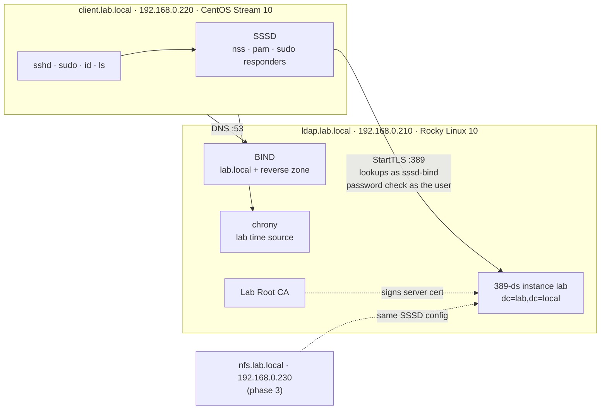

| Layer | Component | Role |
|---|---|---|
| Foundations | BIND, chrony | Every host resolves every other by one canonical name, forward and reverse; all clocks follow ldap |
| Identity | 389-ds | One source of truth for users, groups, UID/GID numbers and sudo rules |
| Transport | Private CA, StartTLS/LDAPS | Encrypts directory traffic and proves the server's identity |
| Clients | SSSD, authselect, oddjob-mkhomedir | Linux lookups (NSS) and logins (PAM) answered from the directory |
| Operations | Scripts, systemd timer | User lifecycle, health check, nightly backup, restore |

UTM bridged networking on 192.168.0.0/24. SELinux is enforcing and firewalld is on for every host.

## Status

| Milestone | Status |
|---|---|
| M0 Foundations: static IPs, DNS, time | done |
| M1 Directory | done |
| M2 TLS | done |
| M3 Access control | done |
| M4 Client (SSSD) | done |
| M5 Operations: lifecycle, health check, backup, restore drill | done |
| M6 Write-up | done |
| Kerberos realm `LAB.LOCAL` | in progress |
| Kerberized NFS | planned |

## What was built

### M0 Foundations: DNS and time

- BIND on ldap is authoritative for `lab.local` and `0.168.192.in-addr.arpa`, and forwards everything else. Recursion is limited to the lab subnet.
- **One name per IP**, so forward and reverse lookups always agree. Kerberos builds service principal names from the reverse lookup.
- chrony on ldap serves time to the lab (`allow 192.168.0.0/24`, `local stratum 10`), and `makestep 1.0 -1` lets paused VMs catch up at once.

Configs: [`configs/dns/`](configs/dns), [`configs/chrony/`](configs/chrony)

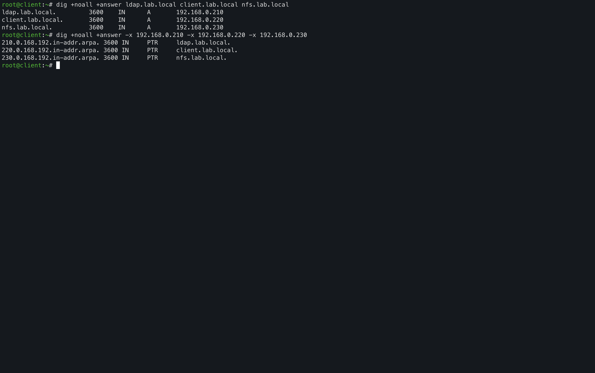
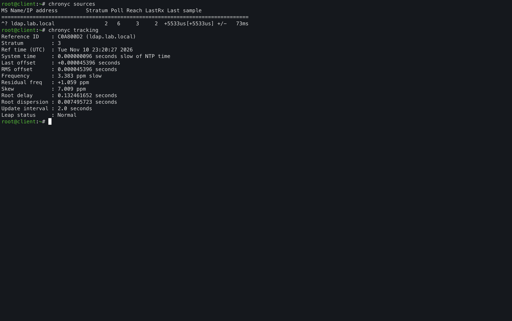

### M1 Directory

- 389-ds instance `lab`, created from [`configs/389ds/lab.inf.example`](configs/389ds/lab.inf.example), with backend `userroot` for `dc=lab,dc=local`.
- **rfc2307bis groups:** `groupOfNames` + `posixGroup` (via the rfc2307compat schema), with members stored by DN. The **memberOf** plugin writes the reverse link onto each user.
- UIDs and GIDs start at 10000, clear of local accounts. Equality indexes on `uidNumber`, `gidNumber`, `member` and `memberOf` are confirmed: lookups don't log `notes=U`.

Tree: `ou=People` (kofi, ama, yaw), `ou=Groups` (ldapusers, sysadmins), `ou=Services` (sssd-bind), `ou=SUDOers`. Source: [`ldif/structure.ldif`](ldif/structure.ldif)

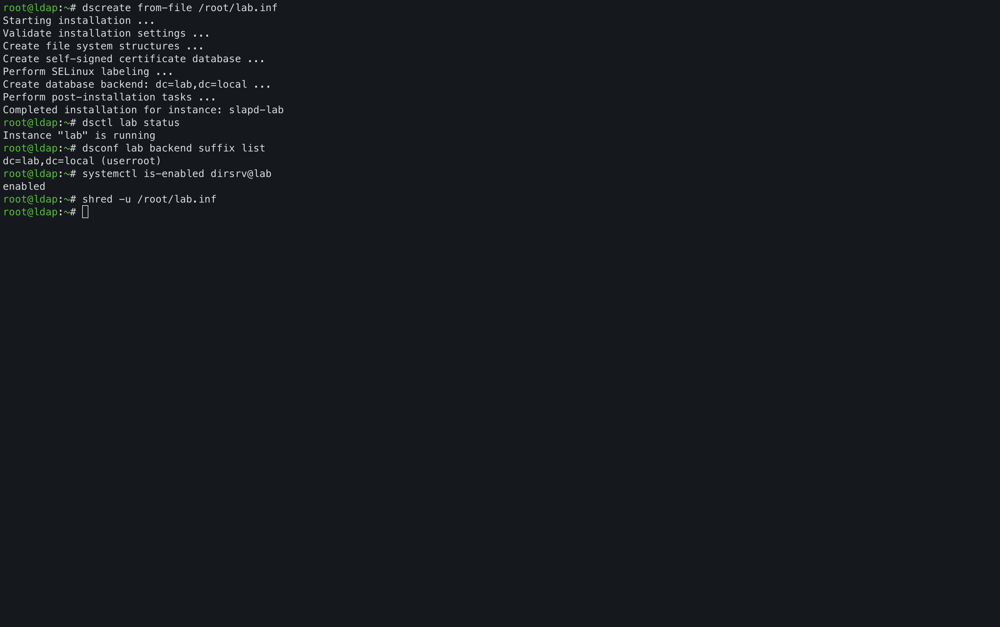
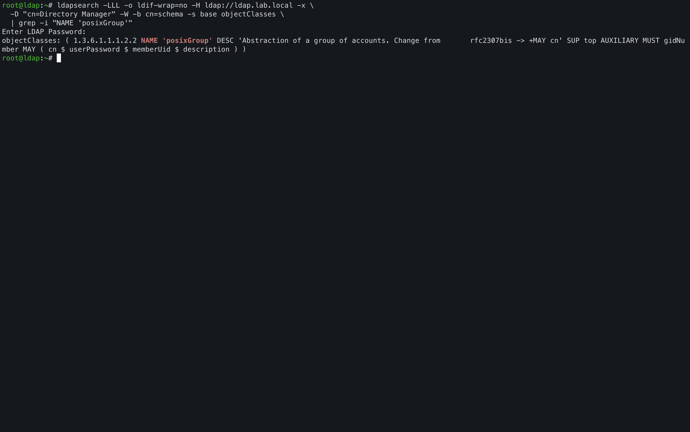
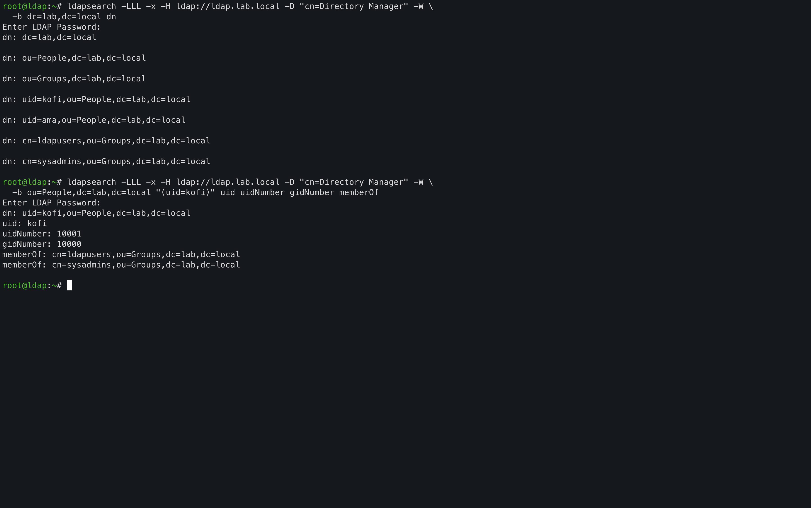
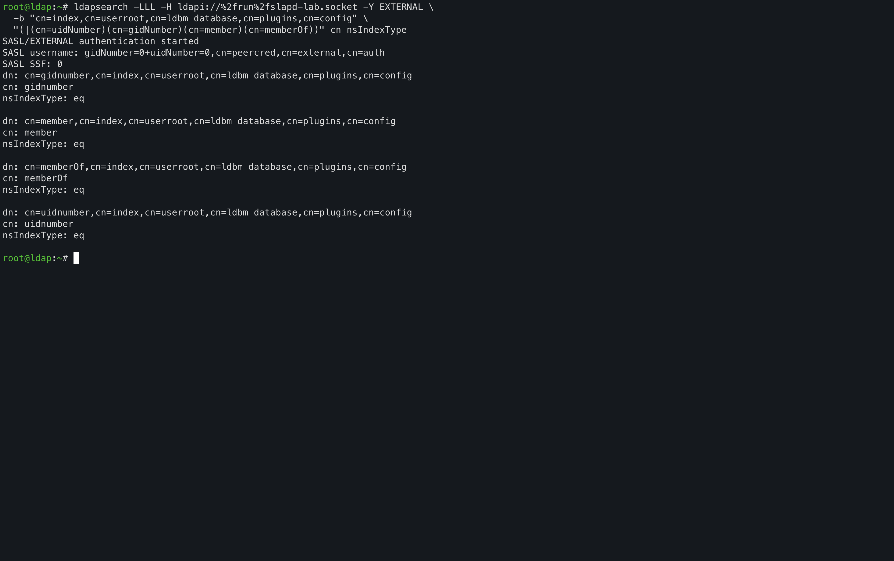

### M2 TLS

- A private root CA ("Lab Root CA", 10 years) signs a server certificate for `ldap.lab.local`, valid for 397 days. It has a SAN, `CA:FALSE` and `serverAuth` only. Extension files: [`configs/tls/`](configs/tls)
- The CA is installed in each host's system trust store. StartTLS on 389 and LDAPS on 636 both verify, including the hostname.
- The negative tests are part of the evidence: an untrusted CA fails with verify code 19, and connecting by IP fails with code 64 (IP address mismatch).

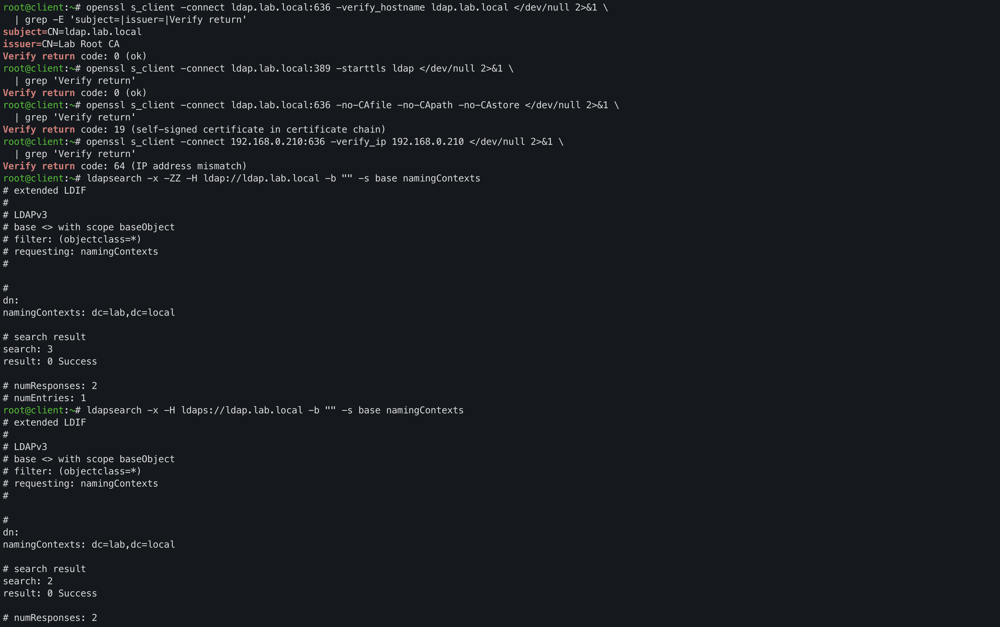

### M3 Access control

- **Password binds require TLS** (`nsslapd-require-secure-binds=on`). Without TLS a bind fails with 13.
- **Anonymous clients can read only the rootDSE** (`nsslapd-allow-anonymous-access=rootdse`). Anything else fails with 48.
- **SSSD binds as `sssd-bind`**, a read-only service account. **Allow-list ACIs** expose exactly the attributes SSSD needs and never `userPassword`. Users may change only their own password. Source: [`ldif/aci.ldif`](ldif/aci.ldif)
- **Password policy:** minimum length 12, and 3 failed binds lock the account for 5 minutes. `ou=Services` has its own subtree policy with no lockout (see [troubleshooting](#troubleshooting-highlights)).
- **Audit:** the only default ACI left is "Enable anyone domain read" on the suffix entry. A logged-in ordinary user (ama) cannot read other users.

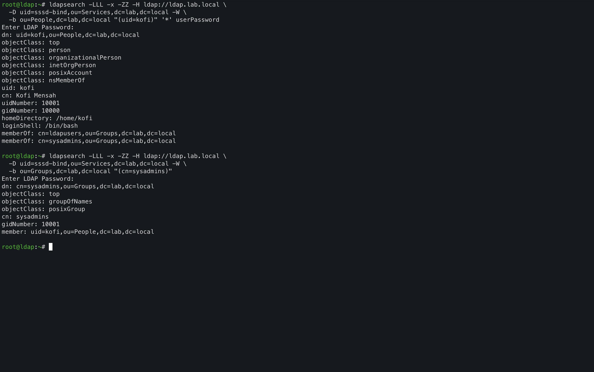
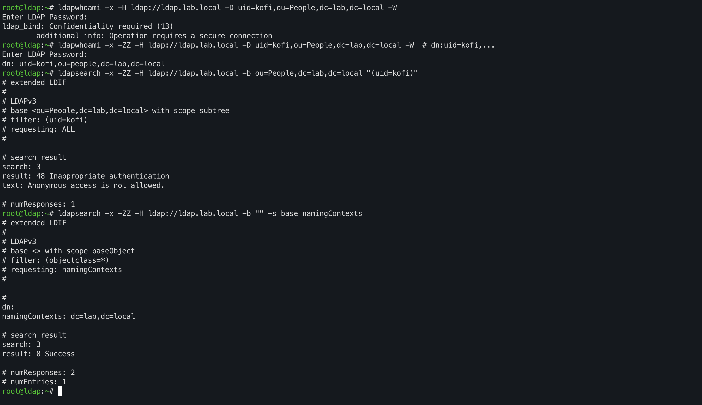
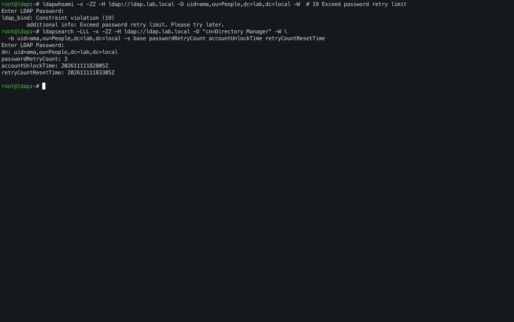

### M4 Client

- SSSD with `ldap_schema = rfc2307bis`, StartTLS and `ldap_tls_reqcert = demand`. Config: [`configs/sssd/sssd.conf.example`](configs/sssd/sssd.conf.example)
- `authselect select sssd with-mkhomedir with-sudo` wires NSS and PAM to SSSD and creates home directories at first login.
- **Login authorization:** `access_provider = simple`, `simple_allow_groups = sysadmins`. kofi logs in; ama's password is correct, but she is refused at the PAM *account* step.
- **Sudo rules come from the directory:** `cn=%sysadmins,ou=SUDOers` gives members of `sysadmins` sudo on every SSSD host, with its own allow-list ACI. Source: [`ldif/sudo.ldif`](ldif/sudo.ldif), [`ldif/aci-sudo.ldif`](ldif/aci-sudo.ldif)

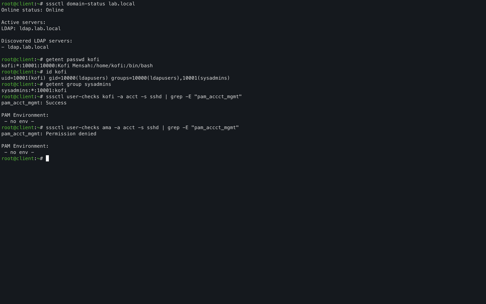
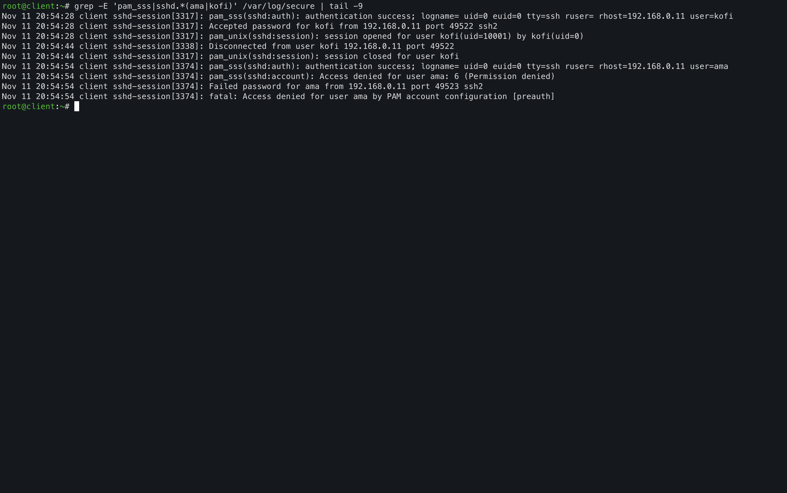
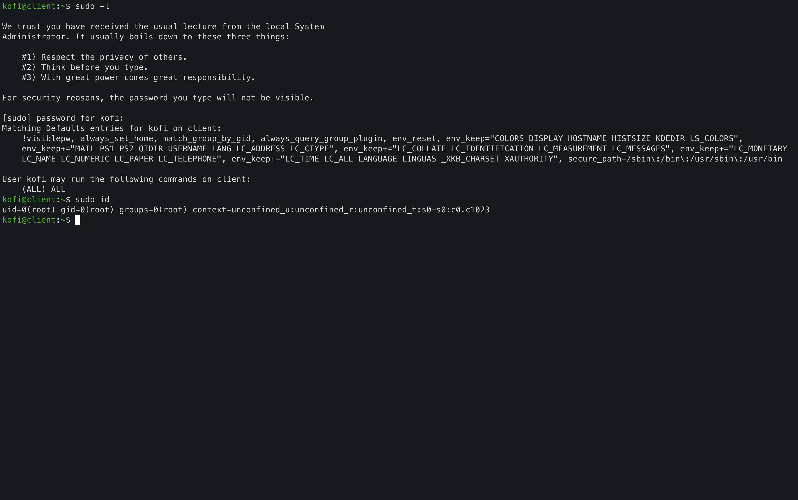

**Reading the login log:** when a user with the right password is refused by `simple_allow_groups`, sshd still logs `Failed password for <user>`, because it reports any PAM failure that way. The pair of `pam_sss` lines above it shows the real cause: `authentication success`, then `account ... Access denied`.

### M5 Operations

See [Operations](#operations).

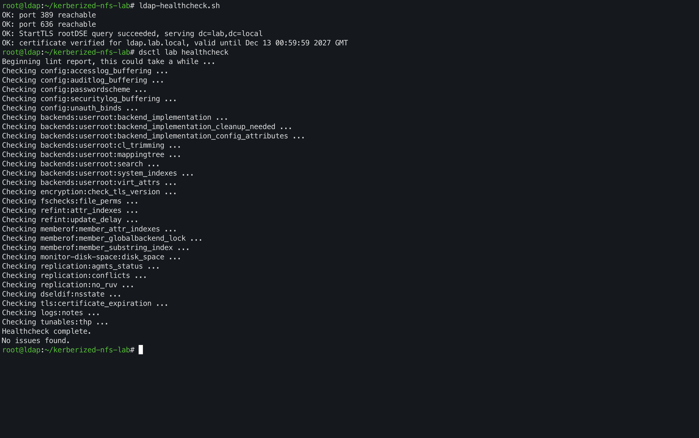
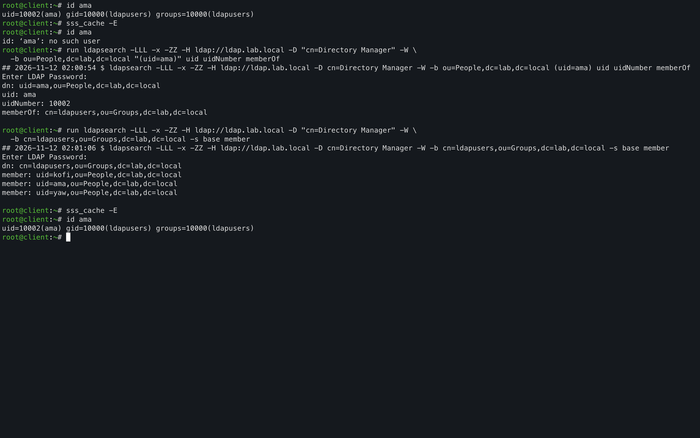
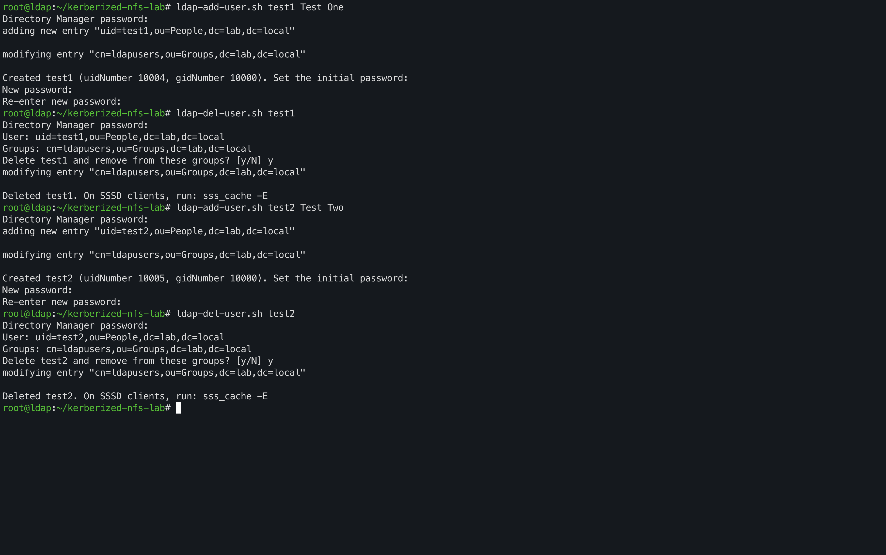

## Design decisions

| Decision | Why | Alternative considered |
|---|---|---|
| Real DNS with reverse zone, one name per IP | Kerberos and TLS both identify hosts by name; `/etc/hosts` copies drift and PTR mismatches break Kerberos | `/etc/hosts` on every host (v1) |
| rfc2307bis + memberOf | Membership by DN keeps references valid, makes "which groups is kofi in?" a single read, and gives ACIs and SSSD a group DN to use | rfc2307 `memberUid` (v1) |
| Allow-list ACIs | Attributes added later (e.g. Kerberos keys if the KDC stores principals in LDAP) stay hidden until granted | `targetattr != "userPassword"` (v1) |
| Service account exempt from lockout, random 32-char password | Lockout on `sssd-bind` lets anyone take every client offline; a long random password makes guessing impractical without lockout | Same policy for every account |
| Login rule per host in `sssd.conf`, sudo rule in LDAP | Different hosts can admit different groups (nfs may admit only admins) while sudo rights stay central | `access_provider = ldap` filter, or FreeIPA-style HBAC |
| DNA plugin assigns `uidNumber` | A deleted user's UID is never reused, so files on shared storage can't pass to a new person | "Highest UID + 1" in the script (v1, and early v2) |
| Private CA instead of a self-signed server cert | Hosts trust one anchor once; later certificates need no client changes | dscreate's self-signed certificate |

## Operations

### Scripts

| Script | Purpose |
|---|---|
| [`ldap-add-user.sh`](scripts/ldap-add-user.sh) | Create a user (`uidNumber` assigned by DNA), add `member` to the primary and any extra groups, set the initial password with `ldappasswd -S` |
| [`ldap-del-user.sh`](scripts/ldap-del-user.sh) | Remove the user's `member` values from every group, then delete; refuses if that would leave a group with no members |
| [`ldap-healthcheck.sh`](scripts/ldap-healthcheck.sh) | Ports 389/636, StartTLS rootDSE query, LDAPS certificate verified against the system trust store, expiry warning at 30 days. Exit codes 0/1/2 (Nagios convention) |
| [`ldap-backup.sh`](scripts/ldap-backup.sh) | Binary backup plus LDIF export; keeps the newest 7 of each |

The admin password goes in a 0600 temporary file read with `-y`, so it never appears on a command line or in `ps`. Group names are resolved before anything is written, so a typo aborts cleanly.

### Account lifecycle

- **Disable first:** `dsidm lab -b dc=lab,dc=local account lock <dn>` sets `nsAccountLock: true`, and binds then fail with 53 "Account inactivated". `account entry-status` shows the state.
- **Delete later** with `ldap-del-user.sh`.
- **Never-reused UIDs:** the DNA plugin hands out `uidNumber` from a counter (10004–19999) that only goes up. In the test, `test1` got 10004 and, after it was deleted, `test2` got 10005.

### Backup and restore

- [`configs/systemd/ldap-backup.timer`](configs/systemd/ldap-backup.timer) runs the backup at 02:30 nightly. `Persistent=true` means a VM that was asleep at 02:30 catches up at its next boot.
- **Restore drill:** take a backup, delete a user, restore the whole database with `dsctl lab bak2db`, then verify on server and client. Both hosts' timestamped logs and a timeline are in [`docs/evidence/m5-restore-drill/`](docs/evidence/m5-restore-drill). The restore took **2 seconds** from stop to start. The user returned with the same UID, `memberOf` and group membership.
- A full restore loses every change made after the backup, so the recovery point is the time of the last backup.

## Troubleshooting highlights

The full log, with the diagnosis path for each problem, is in [`docs/troubleshooting.md`](docs/troubleshooting.md). Three of them:

1. **The network intercepts DNS.** External lookups returned SERVFAIL while lab names worked. The named log showed `broken trust chain` at the first DS record, whichever forwarder was set, and `id.server CH TXT` to 1.1.1.1 timed out. Something upstream answers port 53 itself and strips DNSSEC data. Fixed by turning DNSSEC validation off, as a documented trade-off.
2. **The service account locked itself out.** A wrong password in `sssd.conf` made SSSD fail three binds, the global policy locked `sssd-bind`, and every client went offline. That exposed a design flaw, not just a typo, and led to the subtree policy for `ou=Services`.
3. **Clock offset found in the drill logs.** Laid side by side, the two hosts' logs showed the client "losing" the user before the server deleted her. Client was about 18 s behind, because paused VMs only slewed back (default `makestep 1.0 3`). Fixed with `makestep 1.0 -1` before Kerberos, which rejects more than 5 minutes of skew.

## Known trade-offs

- **Lockout can be abused.** After 3 failed binds an account is locked for 5 minutes. That stops online password guessing, but anyone who knows a username can lock that account on purpose. The short, self-expiring lockout limits the damage, and service accounts are exempt.
- **The CA key is online.** The lab root CA's private key lives on ldap in `/root/ca` (mode 700). A production CA key would be kept offline.
- **`.local` is reserved for mDNS** (RFC 6762). The VMs run no mDNS resolver, so BIND answers normally, but macOS sends `.local` names to mDNS, so the Mac reaches the VMs by IP. A real deployment would use an owned domain or `home.arpa`.
- **DNSSEC validation is off** because the upstream network intercepts port 53. Production would use encrypted DNS (DoT or DoH).
- **The bind password sits on each client.** `sssd-bind`'s password is in each client's `sssd.conf`. Phase 2 can replace it with a SASL/GSSAPI bind using the host keytab.
- **Backups stay on the server's own disk.** A production setup copies them off-host (3-2-1).
- **SSSD caches credentials.** With `cache_credentials = true`, a client that cannot reach the directory still accepts a cached password, so a lock or deletion is not seen there until it reconnects.

## Repository layout

```
configs/dns/      named.conf options (example) and zone files
configs/chrony/   time source and client snippets
configs/389ds/    lab.inf.example
configs/tls/      CA and server certificate extension files
configs/sssd/     sssd.conf.example (client side)
configs/krb5/     krb5.conf for every lab host
configs/systemd/  nightly backup service and timer
ldif/             directory structure, service account, ACIs, sudo rules
scripts/          ldap-add-user.sh, ldap-del-user.sh, ldap-healthcheck.sh, ldap-backup.sh
docs/             troubleshooting.md, screenshots/, evidence/m5-restore-drill/
```

Secrets are never committed: `.gitignore` excludes keys, CSRs, keytabs, `lab.inf` and `sssd.conf`, and the example files carry placeholders.

## Next: Kerberos and NFS

1. **Kerberos realm `LAB.LOCAL`:** a KDC on ldap, with SRV records in the existing zone. Whether principals live in 389-ds or in the KDC's own database is decided at this step; the allow-list ACIs already keep any Kerberos attributes hidden.
2. **SSSD switches to `auth_provider = krb5`,** so a login yields a ticket-granting ticket. Identity and access stay on LDAP. Host keytabs replace the `sssd-bind` password.
3. **nfs.lab.local** joins as an SSSD client, so UIDs match on every host (DNA guarantees they are never reused). It exports a share with `sec=krb5p`. kofi and yaw test access to their own files and to shared group directories.
